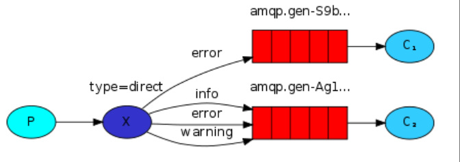

# RabbitMQ

exchange就是在生产者和消费者之间的一个组件，之前的模式是生产者将消息发送给消息队列，所以生产者来决定要将消息发送给哪个消息队列。现在在中间加上一个exchange，生产者将数据发送给exchange，然后exchange决定数据要方法送到哪个消息队列中。

exchange有三种不同的类型，direct，fanout，topic。

## direct

由于一个exchange可以转发不同的数据，所以需要将不同的数据转发到不同的消息队列中（不同的数据可能有不同的处理方式，所以将不同的数据转发到不同的消息队列中，然后消费者消费数据并对数据进行处理）。

生产者是和exchange绑定的，所以生产者是无法感知消息队列的存在的，所以生产者通过exchange_name来指定对应的exchange，并且需要告知exchange这个是什么消息，因为exchange不处理数据，只负责路由数据。所以通过routing_key告诉exchange这个是什么类型的数据，exchange再将数据转发到对应的消息队列中。

一个routine_key可以被绑定在多个消息队列上。例如下面这个图片就是将error绑定到不同的消息队列上，那么就可以得到一个只有error日志的消息队列以及一个有全部日志的消息队列。



## fanout

fanout就是生产者将数据发送给exchange，然后exchange将数据拷贝N份后发送给N个绑定的消息队列（就是exchange会将消息发送给所有绑定这个exchange的消息队列）。可以用在发布订阅的场景下，生产者只需要发送一个数据给exchange，exchange会将这个数据复制成为N份然后将这些数据转发到所有订阅这个exchange的消息队列中。

## topic

topic模式是进阶版的direct模式，只不过是匹配方式的不同罢了。

生产者将数据发送到exchange中，然后exchange根据数据的routine_key将数据转发到对应的消息队列中。

<mark>direct和topic的不同之处</mark>

> direct是<mark>精确路由</mark>，routine_key必须和消息队列的binding_key是一样的才可以；
>
> topic是<mark>模型匹配</mark>，routine_key和消息队列的binding_key进行正则匹配，然后将数据发送到匹配的消息队列上。

# Kafka

## 流程

生产者将消息发送到broker集群中，集群对消息进行topic分类（逻辑层面的分类），topic内部会有多个partition（也就是消息队列），消息最终是存放在partition的，也就是partition才是真正物理层面的存储。broker通过注册中心来指导集群内部各个节点的信息。partition内部会有一个offset指针来指向当前partition消费到哪里了。每个partition只能由<mark>同一个消费者组中的一个消费者</mark>来消费，但是可以由<mark>多个不同的消费者组</mark>来消费。


## 消费者组

一个消费者组下面会有多个消费者，使用Group ID来唯一标识消费者组，消费者组下面的实例（就是单个consumer）订阅topic下的单个partition，对于每个partition来说只能被一个consumer实例消费。

consumer通过offset来知道当前partition消费到哪里。

一个partition只会被一个consumer消费，<mark>那么为什么会存在重复消费的现象呢？</mark>

重复消费就是一条消息被多个消费者消费（重复消费是一个现象，但是不是一个问题，可以配合幂等性等方法来解决重复消费可能带来的问题）。

> 正常的情况下：
>
> 1. 消费者C1从partition拉取消息[100, 101, 102, 103]
> 2. C1成功处理消息101-103
> 3. C1提交偏移量103，那么下次就会从104开始消费
>
> 异常情况下：
>
> 1. 消费者C1从partition拉取消息[100, 101, 102, 103]
> 2. C1成功处理的100-103
> 3. C1在提交偏移量103的适合，C1崩溃了，那么kafaka的协调器就会检测到C1已经死亡，那么100-103的partition就会被重新分配给其他的消费者，那么其他的消费者就会从100开始消费，就导致100-103的数据被重复消费。

<mark>如何解决重复消费的问题呢？</mark>

幂等性原则

> 业务层面：设计业务逻辑，使得不管执行多少次都能得到相同的结果，例如订单支付的时候，不管调用多少次都应该被标记为已支付一次
>
> 数据层面：通过唯一索引来防止重复插入相同的数据
>
> 分布式锁：确保只有一个消费者能够处理某条消息

消息的唯一标识与去重

> 唯一消息ID：在每条消息中添加唯一的业务标识符
>
> 去重存储：消费者在消费前应该检查该消息的唯一ID是否已经被记录，将已处理的消息的唯一ID存在Redis的SET集合或数据库中，如果ID存在则忽略消息

## broker

broker如何知道将消息发送到哪个partition中呢？

> - 如果给消息设置key的话
>
> 如果给消息设置了key，那么对key进行hash运算并取余后会将消息放入哈希后的partition中
>
> - 如果没给消息设置key的话
>
> 如果不设置key，那么就会采用黏性策略，会根据时间间隔，将一个时间间隔内的一批消息都发送到同一个partition中（一个批次的消息会先放入缓冲区中，就是生产者和broker之间其实有一个缓冲区），这个partition是随机选择的。

生产者如何知道发往broker的消息是发送成功了呢？

> broker在接收到消息后会向生产者发送ACK
>
> - ACK = 0 发送消息无需确认是否收到消息，延迟最低，但是丢失风险最高。
> - ACK = 1 发送消息之后需要等待leader的回答，无需等待follower的确认。只要leader将消息写入本地日志，那么就可以确认，性能较好，但是如果leader还未将数据复制到follower就宕机的话，那么这个消息可能就会丢失。
> - ACK = -1 需要等待leader和follower都写入才确定，最安全但是延迟最高。

## 场景题

Kafka如何保证消息100%不丢失呢（不能只靠ACK）

Kafka会在哪些地方导致消息丢失的问题呢？

1. 生产者将消息发送给broker的这个过程

> 生产者将消息发送给broker的时候，broker可能因为网络的问题并没有收到生产者发来的消息
>
> 可以采用ACK的形式，将ACK设置成为all并且搭配合理的重试机制，这样就可以解决大多数因为网络抖动等原因带来的问题。
>
> 下面的例子就可以显示为什么ACK设置成为all还是会导致数据丢失？
>
> 因为数据库事务和发送消息到消息队列不是一个原子操作。

例如下面这个例子，可以借助本地表来保证数据不丢失。

```bash
# 会发生消息丢失的版本
# 在下面这个版本中，由于数据库的事务只能确保数据库的操作（即第 2 步的操作）是原子性的，第 3 步的操作是另一个不同的操作。所以无法保证第三步的操作是原子性的。这样就容易扣减缓存回滚了，但是消息已经发送给MQ了。

1. 开始数据库事务
2. 扣减缓存
3. 生产者发送消息给MQ
4. 提交事务

# 不会发生休息丢失的版本
# 通过待发送消息表来缓存待发送的消息（借助数据库原子操作的特性），这样扣减库存和待发送的消息就是同一个数据库事务，两者要么一起成功，要么一起失败。就不会出现库存扣减了但是回滚了，但是消息还是发送给MQ的情况。

1. 开启数据库事务
2. 扣减库存
3. 将消息写入新建的表中（例如：待发送消息表），这个要和扣减库存的表在同一个数据库中，这样就可以保证数据库的原子性。
4. 提交数据库事务
5. 启动定时任务，定期将待发送消息表中的消息发送到MQ，如果发送成功则将消息的状态设置成为成功或者直接将这个消息删除
```

2. broker将消息持久化存储的时候也会发生消息丢失的问题

> 消息到达了broker，但是如果broker还没来得及将消息持久化到磁盘的时候就宕机了，或者是在集群的环境下，master收到了消息，还没来得及同步到follower节点，master节点就挂了，那么消息也有可能丢失

解决的方法是副本机制

```bash
1. 设置副本数量（replication.factor）：一个master，多个follower，副本分布在不同的机架上；

2. 同步副本（min.insync.replicas）：当ACK设置成为all的时候，如果将这个参数设置成为m的话，那么只要master和m - 1个follower确认了，生产者才会收到ack，这样就可以保证数据的持久化存储；

3. 不干净的leader选举（unclean.leader.election.enable）：默认是false，如果设置为true的话，那么 Leader 宕机，它的某些数据可能还没来得及同步给 Follower。如果此时允许一个数据落后的 Follower 成为新 Leader，那么这些未同步的数据就永远丢失了。
```

3. 消费端消息还没处理完，就已经提前告知broker已经处理好了

> 消费者拉取一批消息后，程序还在处理业务逻辑（比如写入数据库），但后台线程已经默默地帮你把这批消息的位移提交了。如果此时你的服务挂了，Broker 认为已经消费成功。等重启的时候，将从新的位移开始消费，之前那批没处理完的消息，就丢失了。

解决办法是将自动提交关闭，修改成为手动提交，这样如果业务逻辑处理到一半就挂了，也不会自动提交位移。

```bash
1. 从 Broker 拉取消息。
2. 完整地执行完你的所有业务逻辑。当且仅当所有逻辑都成功处理后，再调用 consumer.commitSync() 或 commitAsync() 方法，手动提交位移。
```

手动提交保证了消息的至少消费一次（At-Least-Once），但是会导致消息重复消费的问题。就是如果消息处理成功了，但在提交位移时网络抖动导致失败，消费者重启后会重复消费这条消息。

所以需要将消费端的业务逻辑设计成为幂等的。即同一个操作执行一次和执行N次结果都是一样的。

常见的幂等性实现方法包括：

- 数据库唯一键约束（去重表等）

> 把“已处理过的业务动作”映射为一条唯一记录，重复请求插入同一键会失败，从而达到幂等

- 乐观锁（版本号机制）

> 为目标记录维护**版本号或状态**，每次修改都带上“我期望的版本”。只有当前版本与期望相等，更新才成功；不相等视为“这个动作已经被别人先执行过了（或状态已经前进）”。这样，**重复提交同一动作**时，由于版本已变化，**第二次自然不生效**，达到幂等。

- 分布式锁（如 Redis、Zookeeper）

> 对同一幂等键（如 `message_id`/`order_id`）加短期互斥锁，同一时间只有一个执行者

